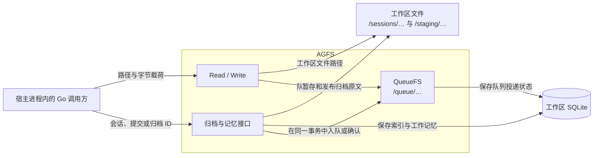

# AGFS 简介与接口图鉴

AGFS 是 Patrol 在宿主进程内使用的 Go 存储接口。调用者通过路径读写工作区文件或操作队列，通过归档接口提交整轮原文、查询归档索引和保存工作记忆。原文以 JSONL 文件保存，归档索引、工作记忆和队列状态保存在同一个工作区 SQLite 数据库中。 [Patrol 架构](./patrol-architecture.md)



## 路径 schema

| 路径 | 语义 | 对应存储 |
| --- | --- | --- |
| `/sessions/<session_id>/<archive_id>.jsonl` | 已发布的会话归档原文 | `<projectDir>/.focus-flash/sessions/<session_id>/<archive_id>.jsonl` |
| `/staging/<archive_id>.jsonl` | 发布前已写入的归档原文 | `<projectDir>/.focus-flash/staging/<archive_id>.jsonl` |
| `/queue/<queue>/<operation>` | 队列操作路径 | 同一工作区 SQLite 中的 QueueFS 队列。 [队列路径及载荷](./queuefs.md#路径接口-schema) |

文件路径使用 AGFS 路径中的正斜杠。AGFS 以数据库所在目录为文件根目录，将文件路径转换为宿主文件路径。`Latest` 同时返回 AGFS 路径 `Archive.Path` 和宿主绝对路径 `Archive.FilePath`。

## Go 接口 schema

`Open` 返回工作区存储句柄 `*Storage`。其余接口是该句柄上的方法。签名中的 `ctx` 类型为 `context.Context`，各接口通过 `error` 返回调用失败。

### 启停与恢复

| 接口签名 | 输入 | 成功结果及状态变化 |
| --- | --- | --- |
| `Open(ctx context.Context, dbPath string) (*Storage, error)` | 工作区 SQLite 文件路径 `dbPath`。Patrol 使用 `<projectDir>/.focus-flash/patrol.sqlite3`。 | 返回可用的存储句柄。创建工作区目录，打开 SQLite，执行迁移并补完已登记的归档提交。 |
| `RecoverQueue(ctx context.Context) error` | 工作区存储句柄与调用上下文。 | 委托 QueueFS 在当前工作区恢复在途消息，保留原消息 ID 和入队顺序。Patrol 在启动 worker 前调用。 |
| `Close() error` | 工作区存储句柄。 | 关闭 SQLite 连接。 |

### 路径读写

| 接口签名 | 输入 | 成功结果及状态变化 |
| --- | --- | --- |
| `Read(ctx context.Context, path string) ([]byte, error)` | AGFS 路径 `path`。 | 文件路径返回文件字节。队列领取路径返回 QueueFS 消息字节，领取事务提交后才返回。队列无待投递消息时返回 `nil, nil`。 |
| `Write(ctx context.Context, path string, data []byte) error` | AGFS 路径 `path` 和字节载荷 `data`。 | 文件路径创建或覆盖对应文件。队列路径按操作执行入队或确认，载荷格式由 QueueFS 定义。 [队列路径及载荷](./queuefs.md#路径接口-schema) |

### 归档与工作记忆

| 接口签名 | 输入 | 成功结果及状态变化 |
| --- | --- | --- |
| `HasArchive(ctx context.Context, sessionID string) (bool, error)` | 工作会话 ID。 | 返回会话是否已有发布的归档。处于 `staged` 的归档在发布后才计入。 |
| `CommitRound(ctx context.Context, commitID string, drafts []ArchiveDraft) ([]string, error)` | 本轮稳定的提交 ID，及按提交顺序排列的归档草稿。提交 ID 和会话 ID 各占一个路径段。 | 返回按草稿顺序排列的归档 ID。先暂存原文并登记提交，再发布文件，最后在同一事务中确认整批归档并入队。重试已登记的提交沿用原档号和路径。草稿为空时返回 `nil, nil`。 |
| `Latest(ctx context.Context, sessionID string) (Archive, WorkingMemory, error)` | 工作会话 ID。 | 返回最近发布的归档，以及截至该档最新保存的工作记忆。无归档时两个结果均为零值。有归档但还未生成记忆时，工作记忆为零值。 |
| `MemoryInput(ctx context.Context, archiveID string) (WorkingMemory, []Archive, error)` | 已发布的目标归档 ID。 | 返回目标档之前最近保存的工作记忆版本，以及该版本覆盖位置之后至目标档的归档索引，按会话内序号升序排列。无旧版本时从序号 1 开始。目标归档不存在或仍在暂存时返回查询错误。 |
| `Settle(ctx context.Context, archiveID string, messageID int64, memory WorkingMemory) error` | 目标归档 ID、从工作记忆队列领取的对应消息 ID 和工作记忆版本。待处理归档的 `memory.CoveredThrough` 须等于目标档序号。 | 在同一事务中保存版本、将归档标记为 `complete` 并确认消息。确认失败时整个事务回滚。已完成的归档再次调用时保留原版本并返回 `nil`。 |
| `Settled(ctx context.Context, archiveIDs []string) (bool, error)` | 需检查的归档 ID 列表。 | 全部归档均为 `complete` 时返回 `true`，空列表也返回 `true`。查到未完成归档即返回 `false`。查询失败时返回错误。 |

## 数据 schema

### `ArchiveDraft`

| Go 字段 | 类型 | 含义 |
| --- | --- | --- |
| `SessionID` | `string` | 归档所属的工作会话 ID。 |
| `Data` | `[]byte` | 归档原文。Patrol 传入 UTF-8 JSONL，AGFS 按字节保存。 |

Patrol 每行写入一条带来源的消息。外层使用 `source` 和 `message`。来源为 `handoff`、`patrol` 或 `agent`。消息字段沿用 `agent.Message`，如下是一条任务派发记录。 [归档编码](../patrol/archive.go) · [Agent 消息结构](../agent/model.go)

```json
{"source":"patrol","message":{"Role":"user","Text":"检查本轮任务","ToolCalls":null,"ToolCallID":"","ToolName":"","ToolError":""}}
```

### `Archive`

| Go 字段 | 类型 | JSON 字段 | 含义 |
| --- | --- | --- | --- |
| `ID` | `string` | `id` | 归档 ID。 |
| `SessionID` | `string` | `session_id` | 所属工作会话 ID。 |
| `Sequence` | `int` | `sequence` | 同一会话内从 1 开始的归档序号。 |
| `Path` | `string` | `path` | 传给 AGFS `Read` 的归档路径。 |
| `State` | `string` | `state` | 归档状态为 `staged`、`pending` 或 `complete`。 |
| `FilePath` | `string` | — | 由 `Latest` 填入的宿主文件绝对路径。Workspace 将它作为 Observation 的 `archive_path`。 |

### `WorkingMemory`

| Go 字段 | 类型 | 含义 |
| --- | --- | --- |
| `L0` | `string` | 从当前状态派生的一句摘要。 |
| `L1` | `string` | 七节 Markdown 记忆正文。 |
| `CoveredThrough` | `int` | 该版本覆盖到的会话内归档序号。零值表示没有已保存的版本。 |
