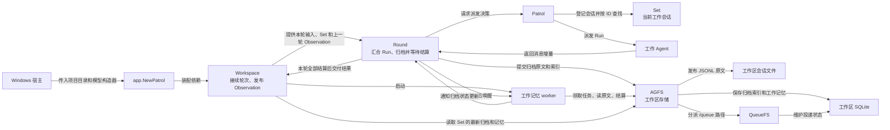

# Patrol 架构

Windows 宿主通过 `app.NewPatrol` 打开工作区存储，从现有 `model` 配置分别装配 Patrol 对话、工作会话和工作记忆所用的模型，并返回 Workspace。Patrol 通过 session-core 的公开接口创建和运行 Agent。 [组合根](../app/app.go) · [Session core](./session-core.md)

## 轮次与工作记忆

1. Workspace 记录用户原文。Patrol 用上一轮 Observation 及其中的输入历史作为前置消息，以本轮输入开启决策会话。`create_context` 新建工作 Agent、登记到 Set 并保留一条交接消息。`send_message` 向 Set 中的会话派发任务，实际派发的 Run 按派发顺序执行。宿主通过 `InstantMessage` 接收进度。
2. Round 收齐 Run 后，按会话合并 `Agent.Run` 返回的消息增量。首档补入一条交接消息，原文包含来源、派发消息、模型回复、工具调用和结果。失败 Run 已返回的消息也归档。AGFS 将 UTF-8 JSONL 写入同卷暂存目录，在 SQLite 登记本轮提交后发布原文文件，再在一个事务中确认整批归档并为每档入队。
3. worker 在进程内通过 AGFS 读取 `/queue/working-memory/dequeue`，QueueFS 用短事务领取最早的待投递任务。worker 读取上一版 L1 和截至目标档的未覆盖原文，调用模型生成并校验七节 L1，从当前状态派生一句 L0。SQLite 在同一个事务写入 L0、L1、覆盖位置和归档完成状态，并确认队列消息。
4. Round 根据 worker 的通知检查本轮归档的结算状态，全部结算后向 Workspace 交付结果。Workspace 读取 Set 中各会话的最新归档索引、原文及 L1，结合用户输入历史组装 Observation。`archive_path` 是宿主机上可直接读取的 JSONL 绝对路径。下一轮在发布完成后开始。

## 存储、恢复和关闭

AGFS 用进程内的 `Read(path)` 和 `Write(path, data)` 分派请求。归档原文位于 `.focus-flash/sessions/<session_id>/<archive_id>.jsonl`，SQLite 位于 `.focus-flash/patrol.sqlite3`。

宿主每个工作区装配一个 Workspace。重开时先迁移 SQLite，并按原提交标识补完已登记的文件发布与入队。QueueFS 将尚未结算的在途消息按原 ID 和入队顺序恢复到待投递，worker 启动后接着领取。Set 和用户输入历史从空开始，新会话使用跨重启唯一的标识。

`Workspace.Close()` 先停止受理输入，等待已受理的轮次收尾，再停止 worker 并关闭 SQLite。尚未结算的任务可在下次启动时继续处理。

[Workspace](../patrol/workspace.go) · [轮次归档](../patrol/archive.go) · [工作记忆](../patrol/working_memory.go) · [AGFS](../internal/agfs/storage.go) · [QueueFS](../internal/agfs/queuefs/queuefs.go)
