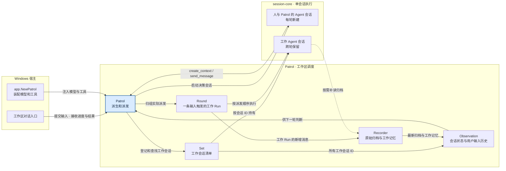

# Patrol 架构

Patrol 为工作区提供一个对话入口。Windows 宿主通过 `app.NewPatrol` 装配对话模型、工作会话模型、Recorder 模型和工作会话可用的工具。Patrol 通过 session-core 的公开接口创建和运行 Agent。 [组合根](../app/app.go) · [Session core](./session-core.md)

## 一轮如何推进

1. Patrol 用上一轮的 Observation 和本次用户消息开启一个新的决策会话。需要派生时，`create_context` 创建工作会话并写入交接消息。`send_message` 派发任务后，新会话的首个模型请求同时包含交接消息和任务。
2. Round 汇集这次派发实际触发的 Run。人与 Patrol 的决策会话在本轮派发完成后结束使用。工作会话继续执行，宿主通过 `InstantMessage` 接收进度。
3. 工作 Run 全部结束后，Recorder 追加原始归档，并结合上一版记忆更新各会话的工作记忆。Patrol 列出 `Set` 里的所有工作会话，连同最新归档、记忆和用户原文生成新的 Observation。下一条输入等待它发布。

工作会话、归档和记忆存放于当前 Patrol 实例的进程内存。 [Patrol](../patrol/patrol.go) · [工具](../patrol/tools.go) · [Recorder](../patrol/recorder.go)
