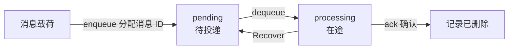

# QueueFS 简介与接口图鉴

QueueFS 是 AGFS 的持久化队列子模块。AGFS 将 `/queue/` 下的请求交给 QueueFS。QueueFS 在工作区 SQLite 中保存消息，按入队顺序领取，并在工作区重启时恢复未确认的在途消息。Patrol 用 `working-memory` 队列把已归档的会话记录交给工作记忆 worker。 [AGFS 接口图鉴](./agfs.md)



## 路径接口 schema

AGFS 调用使用完整路径 `/queue/<queue>/<operation>`。队列名选择操作目标。QueueFS 收到去掉 `/queue/` 前缀的路径。

| 操作 | AGFS 入口与路径 | 请求载荷 | 成功返回 | 状态变化 |
| --- | --- | --- | --- | --- |
| `enqueue` | `Write(ctx, "/queue/<queue>/enqueue", data)` | 合法 JSON 的字节。工作记忆队列使用下文的任务载荷。 | `nil` | 创建一条 `pending` 消息，由 SQLite 分配消息 ID。 |
| `dequeue` | `Read(ctx, "/queue/<queue>/dequeue")` | 通过路径指定队列。 | 消息信封 JSON 的字节。没有待投递消息时返回 `nil, nil`。 | 领取该队列中 ID 最小的 `pending` 消息，将其改为 `processing`。AGFS 提交领取事务后返回。 |
| `ack` | `Write(ctx, "/queue/<queue>/ack", data)` | 正的十进制 `int64` 消息 ID，直接编码为字节。例如 ID 42 对应 `[]byte("42")`。 | `nil` | 删除指定队列中 ID 对应的 `processing` 记录。找不到匹配的在途消息时返回错误。 |

无效路径、读写方式与操作不匹配、非法载荷或 SQLite 失败均通过 `error` 返回。结算工作记忆时，AGFS 将记忆写入、归档完成和队列确认放在同一 SQLite 事务中。 [AGFS 的结算契约](./agfs.md#归档与工作记忆)

## Go 接口 schema

AGFS 使用下列包入口。参数 `path` 的格式为 `<queue>/<operation>`，例如 `working-memory/dequeue`。

| 接口签名 | 输入 | 成功结果及状态变化 |
| --- | --- | --- |
| `Read(ctx context.Context, tx *sql.Tx, path string) ([]byte, error)` | 调用上下文、领取事务和 `<queue>/dequeue` 路径。 | 返回消息信封字节或空队列结果。在传入事务中标记消息为 `processing`，由 AGFS 提交事务。 |
| `Write(ctx context.Context, db executor, path string, data []byte) error` | 调用上下文、SQL 执行器、`<queue>/enqueue` 或 `<queue>/ack` 路径和对应字节载荷。 | 入队创建待投递记录，确认删除在途记录。传入 `*sql.Tx` 时，操作跟随该事务提交或回滚。 |
| `Recover(ctx context.Context, db *sql.DB) error` | 调用上下文和工作区 SQLite 连接。 | 将数据库内各队列的 `processing` 消息恢复为 `pending`，保留原 ID 和入队顺序。 |

`executor` 的契约是提供 `ExecContext(context.Context, string, ...any) (sql.Result, error)`。`*sql.DB` 和 `*sql.Tx` 均可传入。

## 消息 schema

### 领取响应

成功领到消息时，返回的 JSON 信封由消息 ID `id` 和原始 JSON 载荷 `data` 组成。`id` 对应 Go 的 `int64`。`data` 保留入队时的 JSON 值。

```json
{
  "type": "object",
  "properties": {
    "id": {"type": "integer", "minimum": 1, "maximum": 9223372036854775807},
    "data": {}
  },
  "required": ["id", "data"],
  "additionalProperties": false
}
```

### 工作记忆任务

`/queue/working-memory/enqueue` 写入的业务载荷包含归档 ID。worker 从 `/queue/working-memory/dequeue` 得到消息后，用 `data.archive_id` 查询归档，用 `id` 确认该消息。

```json
{
  "type": "object",
  "properties": {
    "archive_id": {"type": "string", "minLength": 1}
  },
  "required": ["archive_id"],
  "additionalProperties": false
}
```

例如，领取工作记忆消息 42 时返回以下响应。

```json
{"id":42,"data":{"archive_id":"round-example-1"}}
```
